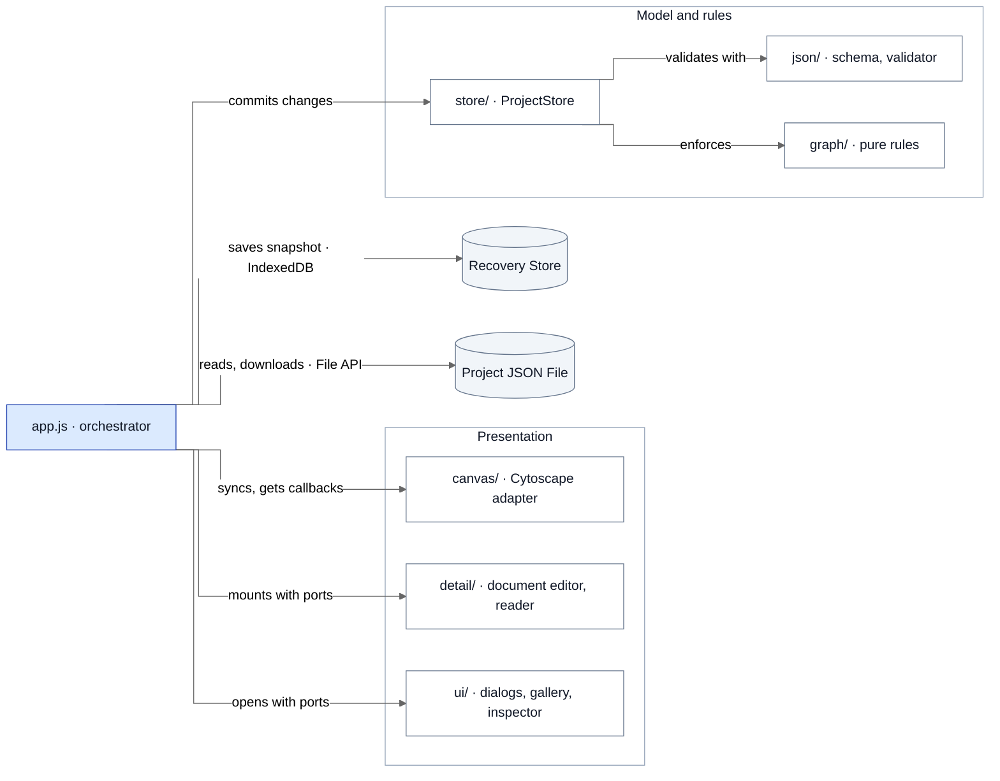

# C4 L3 — Components of the Browser App

**Purpose:** Which parts make up the browser app, and which way do they depend on each other?

**Scope:** C4 L3 Component · container Browser App (`assets/js/`) · audience: developer.

**Explanation:** Arrows show the main call direction. `app.js` is the only module allowed to know everything: it holds session state and connects the presentation modules through explicit callbacks ("ports"); no module imports `app.js` (EV-019). The intended layering (`common` ← `graph`/`json` ← `store` ← presentation ← `app.js`) has a few leaks, listed in the table and as DEBT-002; the gate only blocks cycles, imports of `app.js` and upward imports from `common/`. Every change to the project goes through `ProjectStore.commit`, which validates the whole project with the JSON schema and graph rules before accepting it (EV-005). Presentation modules also call `graph/` and `json/` helpers directly for read-only work (layout, geometry, sanitizing); those many small edges are left out to keep the picture readable and are listed in the table. `common/` (tiny helpers) is used by everyone and is not drawn.

**Evidence:** EV-004, EV-005, EV-019, EV-033, EV-034 — status `VERIFIED`.

**Limitations / Unknowns:** Read-only calls from presentation modules into `graph/` and `json/` are omitted from the diagram on purpose. Recovery and file access are reached through small helpers (`store/recovery.js`, `common/download.js`) called from `app.js`.

**Related:** [Component Index](component-index.md), [Container View](../container-view.md), [Cross-cutting Concepts](../crosscutting-concepts.md).

## Components

| Component | Folder / main files | Responsibility | Imports (observed at 22407c0) | Evidence | Status |
|---|---|---|---|---|---|
| Orchestrator | `app.js` (2,776 lines) | Session state (selection, open dialogs, drafts, views, copy buffer), wiring, guards (draft, pin, layout preview), import/export, recovery | everything | EV-004 | VERIFIED |
| Project store | `store/project-store.js`, `store/recovery.js` | Single source of truth; atomic commits with Undo/Redo (100 steps / 20 MiB); dirty and exported state; opt-in snapshots | `json/`, `graph/`, `common/` | EV-005, EV-008 | VERIFIED |
| JSON contract | `json/schema.js`, `validator.js`, `node-transfer.js`, `selection-export.js` | Schema (Ajv), limits, stage → validate → normalize, serialize, node and selection transfer | `graph/`, `common/`, and `detail/appearance.js`, `detail/attachments.js` (DEBT-002) | EV-006 | VERIFIED |
| Graph rules | `graph/` (18 modules + `types.ts`) | Pure logic: shapes, fit text, groups, pins, Mind Map conversion and radial layout, edge routing, copy/paste, HTML document checks, YouTube ids, diagram policy | `common/`, `json/validator.js` (from `convert-mind.js`), `detail/attachments.js` (from `mind-map.js`) (DEBT-002) | EV-019 | VERIFIED |
| Canvas | `canvas/*.js` | Cytoscape adapter with HTML card overlays, group frames and arrows, resize, edge editor, multi-selection | `graph/`, `detail/` (appearance, text), `i18n/` | EV-033 | VERIFIED |
| Detail | `detail/*.js` | Note document: GrapesJS + CodeMirror editor, HTML import, sanitizing, reading frame, Mermaid, video, element library | `graph/`, `json/`, `common/`, `i18n/`, `ui/forms.js`, `ui/dialog-surface.js` | EV-012, EV-034 | VERIFIED |
| UI | `ui/*.js` | Native dialogs, toasts, template gallery, format inspector, group editor, quick help, ChatGPT shortcut, pet | `graph/`, `json/`, `common/`, `i18n/`, `detail/`, and `store/project-store.js` search helpers (DEBT-002) | EV-038 | VERIFIED |
| Word export | `word-export/*.js` (9 modules) | Project to `.docx`: IR from the note document, OOXML parts, ZIP store; `browser.js` adds labels, WebP to PNG and the download. Loaded lazily from `app.js` | `graph/`, `common/`, `detail/attachments.js`; `browser.js` also `i18n/`, `json/validator.js` | EV-042 | VERIFIED (working tree, uncommitted at 22407c0) |
| i18n | `i18n/index.js`, `vi.js`, `en.js` | `t(key)` with Vietnamese default and English | — | EV-022 | VERIFIED |
| Common | `common/data.js`, `dom.js`, `download.js`, `html.js` | Clone, DOM helpers, file download, HTML escaping; must not import domain or UI | nothing above it | EV-019 | VERIFIED |

## Interfaces, state, errors, tests

- **Interface:** presentation modules receive callbacks such as `onApply`, `isCurrent`, `connection`, `groupConnection` from `app.js`; they return results through those callbacks only.
- **State:** project state lives in the store; everything else (selection, drafts, open panels, locale, copy buffer) is session memory in `app.js` and is never exported.
- **Errors:** a failed commit throws (`invalidProject`, `pinnedCardLocked`); `app.js` shows a toast or an error dialog and the project stays unchanged (EV-005, EV-038).
- **Tests:** pure modules have `node --test` unit tests; behavior is covered by Playwright specs ([Test Strategy](../../05-security-quality/test-strategy.md)).
