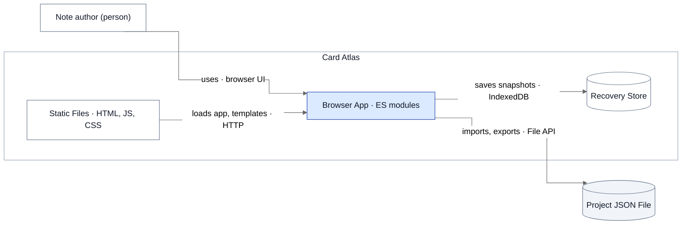

# C4 L2 — Container View

**Purpose:** Which applications and data stores make up Card Atlas, and how do they communicate?

**Scope:** C4 L2 Container · inside the system boundary · audience: developer, operator.

**Explanation:** Boxes inside "Card Atlas" are containers; gray boxes are outside the system. The **Browser App** is the only running application: `index.html` loads `assets/js/app.js` as an ES module and everything runs in one browser tab (EV-002, EV-004). **Static Files** is the folder of HTML, JavaScript, CSS, vendor bundles and template JSON, served over HTTP; in this repository the only server is the dev server (EV-003). The **Recovery Store** is IndexedDB, used only when the user turns recovery on (EV-008). The **Project JSON File** is the user's own file, outside the system (EV-010). The Browser App's calls to remote image hosts and YouTube (both `HTTPS`, from the user's browser) are listed in the table and drawn in the [System Context](system-context.md) and [Data Flows](../04-data-integrations/data-flows.md); leaving them out here keeps the labels readable. ChatGPT is a separate window, not a call from the app.

**Evidence:** EV-002, EV-003, EV-004, EV-008, EV-010, EV-011, EV-014, EV-016, EV-018 — status `VERIFIED`.

**Limitations / Unknowns:** Which web server serves the static files outside development is `UNKNOWN` (no hosting configuration, EV-027). A `localStorage` flag that switches recovery on is part of the Recovery Store row.

**Related:** [System Context](system-context.md), [Component Index](components/component-index.md), [Deployment View](deployment-view.md).

| Container | Responsibility | Technology / version | Talks to | Evidence | Status |
|---|---|---|---|---|---|
| Browser App | Whole product: canvas, editor, reading view, validation, undo, import/export | Vanilla ES modules; vendor bundles (Cytoscape 3.34.3, GrapesJS 0.23.9, Mermaid 12.3.0 …) | Static Files, Recovery Store, Project JSON File, image hosts, YouTube | EV-004, EV-018 | VERIFIED |
| Static Files | `index.html`, `assets/js`, `assets/css`, `assets/vendor`, `assets/data` (templates, schema, prompt) | Any HTTP static server; dev: `scripts/serve.mjs` | Browser App | EV-003, EV-011 | VERIFIED |
| Recovery Store | Last project snapshot for crash recovery (opt-in) | IndexedDB `card-atlas-recovery` + `localStorage` flag | Browser App | EV-008 | VERIFIED |

## Symptom → container (for debugging)

| Symptom | Suspect container | First check |
|---|---|---|
| Blank page, editor never appears, templates fail to load | Static Files | Served over HTTP (not `file://`)? `assets/vendor/` built? See [runbook](../06-operations/runbooks/app-does-not-load.md) |
| Import refused, changes rejected | Browser App (validator) | Error list in the import preview; see [runbook](../06-operations/runbooks/import-rejected.md) |
| Work missing after a crash | Recovery Store | Was recovery enabled before the crash? |
| Image or video not shown | Remote host / YouTube | Network access; host blocks hotlinking; video forbids embedding |
