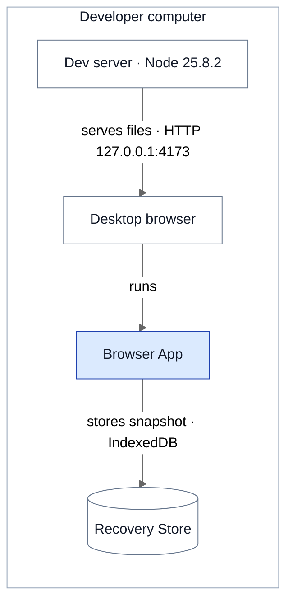

# Deployment View

**Purpose:** Where does each container run today?

**Scope:** Deployment · local development (the only environment found) · audience: developer, operator.

**Explanation:** `npm run dev` starts `scripts/serve.mjs`, which binds 127.0.0.1:4173, serves only `/`, `/index.html` and `/assets/…`, and sends `Cache-Control: no-store` (EV-003). The browser runs the app and, when recovery is on, keeps one snapshot in IndexedDB (EV-008). Nothing is reachable from other machines.

**Evidence:** EV-003, EV-008, EV-028 — status `VERIFIED`.

**Limitations / Unknowns:** No production or shared environment is defined in the repository (no CI, container or hosting files, EV-027). If the app is published as static files elsewhere, that host, its TLS and its caching are `UNKNOWN`.

**Related:** [Container View](container-view.md), [Environments](../06-operations/environments.md), [Build and Release](../06-operations/deployment.md).

| Node | Runs | Configured in | Evidence | Status |
|---|---|---|---|---|
| Developer computer | Node dev server, desktop browser (Chrome / Edge / Firefox) | `package.json` `dev`, `scripts/serve.mjs` | EV-003 | VERIFIED |
| Any other host | UNKNOWN | — | EV-027 | UNKNOWN |
