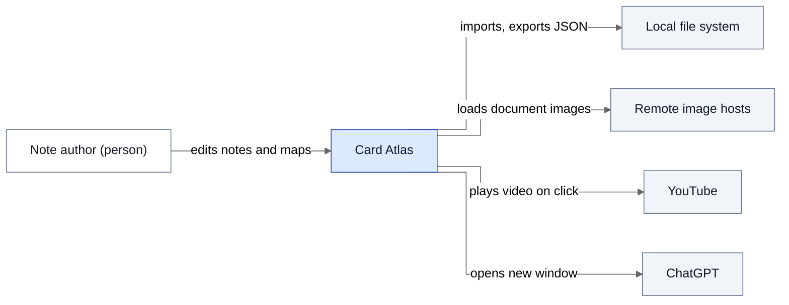

# C4 L1 — System Context

**Purpose:** Who uses Card Atlas, and which outside systems does it touch?

**Scope:** C4 L1 System Context · Card Atlas · audience: everyone.

**Explanation:** The blue box is the system; gray boxes are outside it. There is one kind of user and no other system calls Card Atlas. The local file system is outside the system: the app only sees the files the user picks and saves (EV-010). Remote images load automatically when a document references them (EV-014); YouTube loads only after the user presses play (EV-016); the ChatGPT shortcut opens a separate window and sends nothing (EV-017).

**Evidence:** EV-002, EV-010, EV-014, EV-016, EV-017 — status `VERIFIED`.

**Limitations / Unknowns:** Links inside documents open any `http(s)` site in a new tab; that is the user's navigation, not an integration, and is not drawn. Whether the app is hosted for other users is `UNKNOWN`.

**Related:** [Container View](container-view.md), [External Systems](../04-data-integrations/external-systems.md).

## Actors and interactions

| Actor / system | Interaction | Direction | Evidence | Status |
|---|---|---|---|---|
| Note author (person) | Creates and edits cards, links, groups and documents; imports and exports projects | Inbound | EV-002 | VERIFIED |
| Local file system | `<input type="file">` to read a project; Blob download to save one | Both, user-initiated | EV-010 | VERIFIED |
| Remote image hosts | Browser fetches `http(s)` images referenced in a document | Outbound | EV-014 | VERIFIED |
| YouTube (`youtube-nocookie.com`) | Embedded player after a click on a video placeholder | Outbound | EV-016 | VERIFIED |
| ChatGPT (`chatgpt.com`) | Opened in a new window; no data passed | Outbound navigation | EV-017 | VERIFIED |

## Boundary

Inside: everything served from `index.html` and `assets/`. Outside: the user's files, every third-party site, and the browser itself. By policy nothing is uploaded and no analytics are sent (EV-030).
