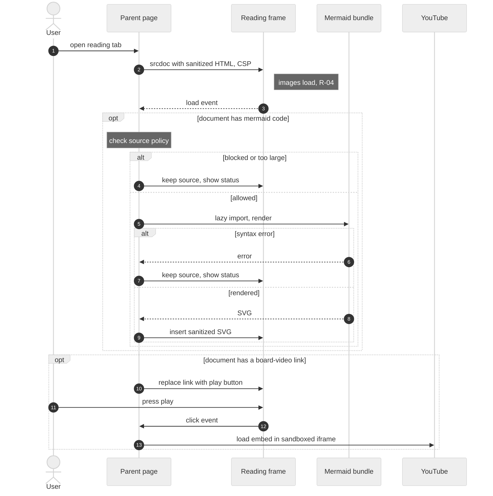

# Workflow — Read a Document with Diagrams and Video

**Trigger:** opening a card's reading tab · **Entry point:** `renderHTMLDocument()` in `assets/js/detail/html-content.js` (line 146)

## Overview

**Purpose:** How is a stored document shown, and which parts reach the network?

**Scope:** Runtime sequence · Detail reading view · audience: developer, security reviewer.

**Explanation:** The note after step 2 marks risk R-04: remote images load as soon as the frame renders. The stored document is already sanitized; the frame gets it as `srcdoc` with `sandbox` but no `allow-scripts`, and a CSP `default-src 'none'` (EV-012, EV-013). Because the frame cannot run scripts, the parent page draws Mermaid: it checks the source against a policy (no init directives, styles, clicks or URLs; size and count limits), lazy-loads the vendored Mermaid bundle, renders with `securityLevel: 'strict'` and inserts SVG sanitized again by DOMPurify without `foreignObject` (EV-015, EV-018). Video links become a 16:9 placeholder; nothing is requested from YouTube until the user presses play, and the player is a sandboxed iframe from `youtube-nocookie.com` laid over the placeholder in the parent page (EV-016).

**Evidence:** EV-012, EV-013, EV-015, EV-016, EV-018 — status `VERIFIED`.

**Limitations / Unknowns:** Remote `http(s)` images in the document load as soon as the frame renders, without a click (EV-014); this is not drawn. The frame is same-origin by design so the parent can script it; any future change that adds `allow-scripts` would remove the isolation.

**Related:** [Security Architecture](../../05-security-quality/security-architecture.md), [External Systems](../../04-data-integrations/external-systems.md), [ADR 0003](../../07-decisions-changes/adr/0003-sanitized-html-sandboxed-frame.md).

## Step fails → symptom → check

| Step | Function / route | Fails how | Symptom | Check | Evidence | Status |
|---|---|---|---|---|---|---|
| Policy | `isSafeDiagramSource` | Source uses `style`, `classDef`, `click`, `%%{` or a URL | Source shown with "not supported" status | Remove those lines | EV-015 | VERIFIED |
| Render | `mermaid.render` | Syntax error or ELK layout requested | Source shown with "could not draw" status | Mermaid syntax | EV-015 | VERIFIED |
| Play | `mountVideoPlayers` | No network, video forbids embedding | Error inside the player | Use *Mở trên YouTube* link | EV-016 | INFERRED (because YouTube's own error page was not tested) |
| Images | frame CSP | Host blocks hotlinking or no network | Broken image | Open the image URL directly | EV-014 | INFERRED |
