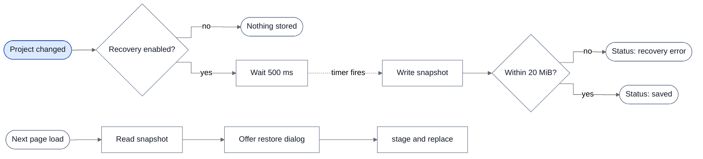

# Workflow — Opt-in Recovery Snapshot

**Trigger:** any render while recovery is enabled; page load · **Entry point:** `scheduleRecovery()` (line 1905) and `initializeRecovery()` (line 2011) in `assets/js/app.js`

## Overview

**Purpose:** When is a recovery copy written, and how is it offered back?

**Scope:** Workflow · recovery · audience: developer, operator.

**Explanation:** Recovery is off by default; turning it on sets a `localStorage` flag, turning it off deletes the IndexedDB database (EV-008). With recovery on, each change resets a 500 ms timer that writes one snapshot under the key `current` (dashed: deferred). A snapshot over 20 MiB is refused with a status message. On the next load the snapshot is offered; restoring stages it like an import (EV-006) and replaces the project.

**Evidence:** EV-006, EV-008 — status `VERIFIED`.

**Limitations / Unknowns:** Only the latest snapshot is kept. Browser storage can be cleared by the browser or the user; nothing warns about that.

**Related:** [Backup and Restore](../../06-operations/backup-restore.md), [Data Flows](../../04-data-integrations/data-flows.md).

## Step fails → symptom → check

| Step | Function / route | Fails how | Symptom | Check | Evidence | Status |
|---|---|---|---|---|---|---|
| Write | `saveRecovery` | Over 20 MiB, quota, private mode | Toast and status "recovery error" | Browser storage settings | EV-008 | VERIFIED |
| Read | `readRecovery` | Database blocked or cleared | No restore offered | Was recovery on before? | EV-008 | VERIFIED |
| Restore | `stage` | Snapshot invalid | Restore refused | Export manually next time | EV-006 | VERIFIED |
