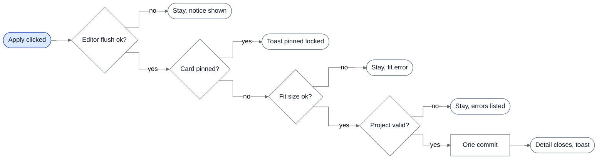

# Workflow — Edit and Apply a Note Document

**Trigger:** *Áp dụng* (Apply) in the Detail editor tab · **Entry point:** `form.onsubmit` in `assets/js/app.js` (line 1409) → `applyDraft()` (line 1529)

## Overview

**Purpose:** How does an edited note document become part of the project, and when is it refused?

**Scope:** Workflow · Detail editor · audience: developer.

**Explanation:** While the user edits, the block editor (GrapesJS, or CodeMirror in HTML code mode) writes the sanitized document, its plain text and any image attachments into the draft (`mountBlockEditor` callback, EV-034, EV-012). Apply first asks the editor to flush; HTML code mode refuses when the source still has removed parts. Then `applyDraft` refuses pinned cards (EV-023), checks the form, measures fit size when the card is in fit mode, validates a full copy of the project (EV-006), and commits once, so the whole edit is one Undo step (EV-005). On success the Detail dialog closes with a success toast.

**Evidence:** EV-005, EV-006, EV-012, EV-023, EV-034 — status `VERIFIED`.

**Limitations / Unknowns:** A pending HTML import or sample preview inside the editor is not part of the draft until the user adds it.

**Related:** [User Action Lifecycle](../request-lifecycle.md), [Read a Document](../events/read-document-media.md).

## Step fails → symptom → check

| Step | Function / route | Fails how | Symptom | Check | Evidence | Status |
|---|---|---|---|---|---|---|
| Flush | `blockEditor.flush` | HTML code has unsupported parts | Notice "HTML code rejected" | Remove the listed parts | EV-012 | VERIFIED |
| Pin | `applyDraft` | Card is pinned | Toast | Unpin first | EV-023 | VERIFIED |
| Fit | `measureOverview` | Content does not fit | "fit overflow" message | Shorter text or manual size | EV-005 | VERIFIED |
| Validate | `validate` | Limit or rule broken (e.g. 100,000 characters) | Errors in the form | Error paths | EV-006 | VERIFIED |

## Preconditions, authentication, idempotency

No authentication. Applying an unchanged draft adds no Undo step.
