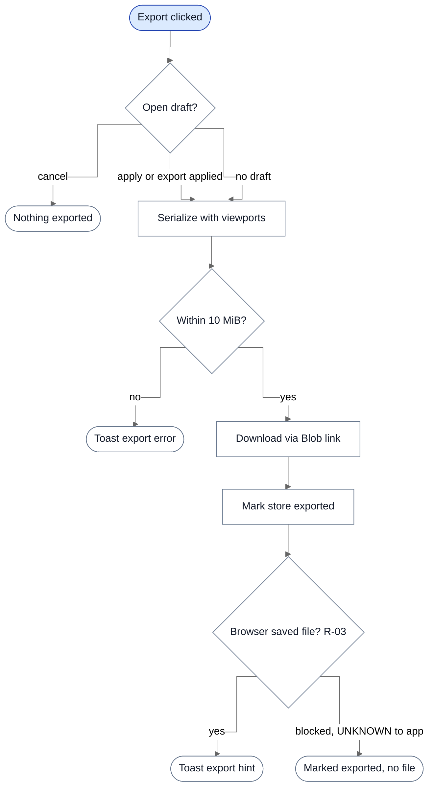

# Workflow — Export a Project File

**Trigger:** toolbar *Xuất dự án* (action `export`) · **Entry point:** `exportProject()` in `assets/js/app.js`

## Overview

**Purpose:** How does the project become a file on disk, and when does export refuse?

**Scope:** Workflow · export project JSON · audience: developer.

**Explanation:** The last decision is not made by the app: it cannot observe whether the browser saved the file, so a blocked download still marks the project exported (R-03). With an open draft the user chooses to apply it and export, export the applied state, or cancel. `serialize` writes the project as indented JSON with the Note Board viewport in `canvas` and the Mind Map viewport in `card-atlas:views` (EV-010). Output over 10 MiB is refused (EV-006). The file name comes from the project title with characters invalid on common file systems replaced. After a download the store is marked exported, so the unload prompt stops asking (EV-021).

**Evidence:** EV-006, EV-010, EV-021 — status `VERIFIED`.

**Limitations / Unknowns:** The app cannot know whether the browser actually saved the file (download blocked, user cancelled a save dialog); it still marks the project exported. The browser chooses the folder; see [Known Risks](../../07-decisions-changes/known-risks.md) R-03.

**Related:** [Import](import-project.md); [Export a Word document](export-word.md) (read-only copy, does not mark the project exported); selection export (only selected cards) uses `json/selection-export.js` (EV-031) and the same download helper.

## Step fails → symptom → check

| Step | Function / route | Fails how | Symptom | Check | Evidence | Status |
|---|---|---|---|---|---|---|
| Draft | `exportProject` dialog | Apply fails validation | Export stops, draft stays | Fix the draft | EV-010 | VERIFIED |
| Size | `exportProject` | > 10 MiB | Toast `errorExport` | Remove large images | EV-006 | VERIFIED |
| Download | `common/download.js` | Browser blocks download | No file, but project marked exported | Browser download settings | EV-010 | INFERRED (because the code does not observe the download result) |

## Preconditions, authentication, idempotency

No authentication. Exporting twice writes two identical files (the browser may rename the second).
