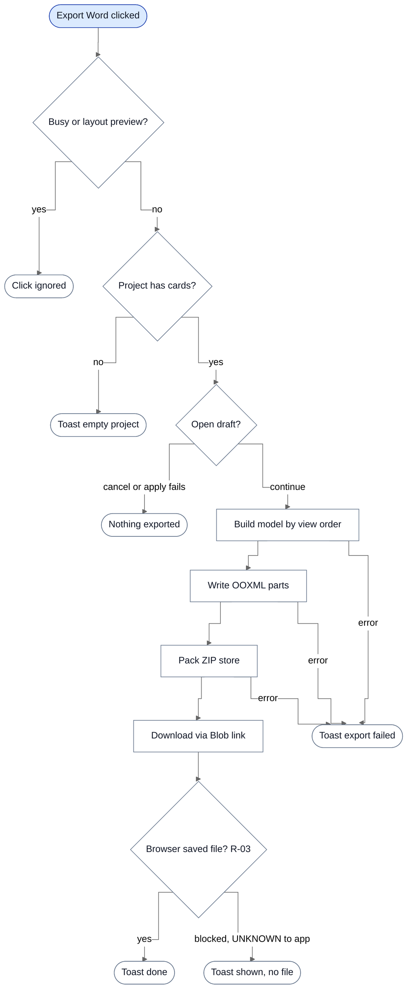

# Workflow — Export a Word Document

**Trigger:** toolbar *Xuất Word* (action `export-word`) · **Entry point:** `exportWord()` in `assets/js/app.js`

## Overview

**Purpose:** How does the project become a readable `.docx` file, and when does the export stop?

**Scope:** Workflow · export project to Word · audience: developer.

**Explanation:** `exportWord` ignores the click while a previous export is running or a layout preview is open, and shows a toast for a project with no cards. It then reuses the same draft dialog as the JSON export through `resolveExportDraft()` (cancel keeps the draft; an invalid apply stops) (EV-043). The build runs in `assets/js/word-export/`, loaded lazily with `import()`: `wordDocument` orders cards by the active view (Mind Map: depth-first from the root; Note Board: y, x, id) inside the group tree, `docxParts` writes the OOXML parts, `zipStore` packs them uncompressed (EV-042, EV-044). Images stored in the project are embedded; web images are written as links and never fetched, which keeps the "no upload, no extra network" policy (EV-030, EV-032). WebP images are re-encoded to PNG in the browser; a failure drops only that image and is counted in the toast. Unlike the JSON export, the store is not marked exported and `lastExport` is not set, so the unload warning still appears; the toast adds a "not saved" detail when the project is dirty.

**Evidence:** EV-030, EV-032, EV-042, EV-043, EV-044, EV-045 — status `VERIFIED` (working tree, see Limitations).

**Limitations / Unknowns:** The word-export code and the `exportWord` wiring were not committed when this page was written: they are verified against the working tree on top of `22407c0` ("uncommitted at 22407c0"), so line numbers in the register may move. As with the JSON export, the app cannot observe whether the browser saved the file (download blocked, save dialog cancelled); see [Known Risks](../../07-decisions-changes/known-risks.md) R-03. The produced file was not opened in Microsoft Word or LibreOffice (neither is available); only structure and well-formedness are tested (EV-045). A `.docx` cannot be imported back.

**Related:** [Export a project file](export-project.md) (JSON, marks the project exported); [Data Flows](../../04-data-integrations/data-flows.md); component table in [Browser App](../../01-architecture/components/browser-app.md).

## Step fails → symptom → check

| Step | Function / route | Fails how | Symptom | Check | Evidence | Status |
|---|---|---|---|---|---|---|
| Guard | `exportWord` | Layout preview open or export already running | Click does nothing | Close the preview; wait for the toast | EV-043 | VERIFIED |
| Empty | `exportWord` | No cards | Toast `wordExportEmpty`, no file | Add a note | EV-043 | VERIFIED |
| Draft | `resolveExportDraft` | Apply fails validation or user cancels | Export stops, draft stays | Fix or discard the draft | EV-043 | VERIFIED |
| Build | `buildDocx` | Exception while mapping or packing | Toast `wordExportFailed`, error in the console, project unchanged | Browser console; run `node --test tests/word-docx-core.test.mjs` | EV-042, EV-045 | VERIFIED |
| Images | `transcodeToPng` | WebP cannot be decoded | Toast `wordExportDoneSkipped`; the image appears as its name | Re-save the image as PNG or JPEG | EV-042 | VERIFIED |
| Download | `common/download.js` | Browser blocks download | Success toast but no file | Browser download settings | EV-043 | INFERRED (because the code does not observe the download result) |
| Open in Word | external | Word reports a damaged file | Repair dialog | Unzip and check `word/document.xml` is well formed; report the file | EV-045 | UNKNOWN (never opened in Word) |

## Document layout

The layout follows the owner's template `Claude_With_Menu.docx` (EV-042, EV-044): Aptos styles, a cover with the board logo (`assets/images/brand/logo-word.png`, fetched from the same origin; export continues without it on failure), the project title and description, then a contents page whose entries are internal links to groups and cards (one section per top-level group, ungrouped cards last), then a page break. Every page has a header with a small logo and the project title, and a footer with the page number. A card whose title repeats its group's title is merged into the group heading, and a document heading or first paragraph that repeats the card title or summary is dropped. In practice an open draft is caught first by the Format dock's own guard (the toolbar is inert while Detail is modal), so the user resolves the draft and clicks again.

## Preconditions, authentication, idempotency

No authentication. Exporting twice writes two files with the same name (the browser may rename the second); the ZIP date is fixed, so the same project and view give identical bytes.
