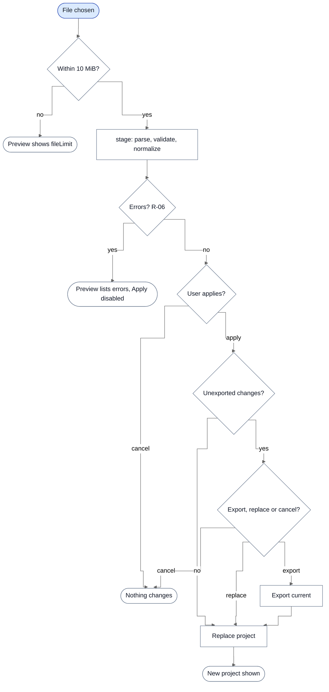

# Workflow — Import a Project File

**Trigger:** toolbar *Nhập JSON* (action `import`) · **Entry point:** `#file-input` change → `importFile(file)` in `assets/js/app.js`

## Overview

**Purpose:** What happens from choosing a file to the new project on screen, and where can it stop?

**Scope:** Workflow · import project JSON · audience: developer.

**Explanation:** A file written by a newer version with an extra optional field fails at the error check in an older version (R-06). The size is checked before the file is read; a file over 10 MiB is never parsed (EV-006, EV-009). `stage` parses the text (syntax errors report line and column), validates, normalizes legacy shapes and validates again. The preview dialog shows title, card and relation counts, errors, warnings and the adjustments made; Apply is disabled while there are errors. Before replacing, open drafts must be resolved, and a project with unexported changes offers to export it first (EV-009, EV-010). Replacing resets selection, drafts and search and clears Undo history.

**Evidence:** EV-002, EV-006, EV-009, EV-010 — status `VERIFIED`.

**Limitations / Unknowns:** The draft guard before replacing is not drawn; it can also cancel the import.

**Related:** [Export a Project File](export-project.md), [Runbook: import rejected](../../06-operations/runbooks/import-rejected.md), [Data Model](../../04-data-integrations/data-model.md).

## Step fails → symptom → check

| Step | Function / route | Fails how | Symptom | Check | Evidence | Status |
|---|---|---|---|---|---|---|
| Size | `importFile` | > 10 MiB | Preview error `fileLimit` | File size | EV-009 | VERIFIED |
| Read | `file.text()` | Browser cannot read | Toast "cannot read" | File permissions, encoding | EV-009 | VERIFIED |
| Parse | `stage` | Invalid JSON | Error with line and column | Open the file in an editor | EV-006 | VERIFIED |
| Validate | `validate` | Contract or limit broken | Error list with paths and codes | [Runbook](../../06-operations/runbooks/import-rejected.md) | EV-006 | VERIFIED |
| Export first | `exportProject` | Export fails | Import stops, toast | See [Export](export-project.md) | EV-010 | VERIFIED |

## Preconditions, authentication, idempotency

No authentication. Importing the same file twice gives the same project; each import replaces the current one and clears history.
