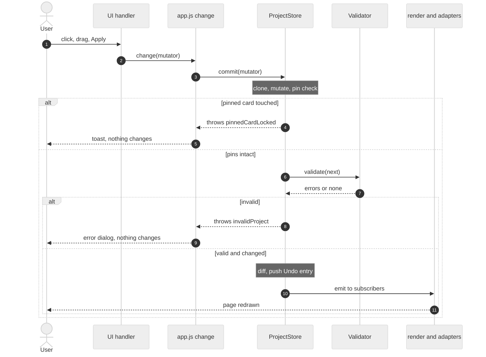

# User Action Lifecycle

There are no HTTP requests: a "request" is a user action in the page. This page traces any action that changes the project, for example dragging a card, applying a draft or creating a group.

**Purpose:** What happens from a user action to the new project state on screen, and what happens when the change is not allowed?

**Scope:** Runtime sequence · Browser App · audience: developer.

**Explanation:** Every change goes through one function, `change(mutator)` in `app.js`, which calls `ProjectStore.commit` (EV-004, EV-005). The store works on a clone, so a refused change leaves the visible project untouched. A pin violation is refused before validation (EV-023); any schema or rule error throws `invalidProject` with the issue list (EV-006). An accepted change stores a diff for Undo (100 steps / 20 MiB) and notifies subscribers; `render` then syncs the canvas, panels and the save-state indicator and schedules a recovery snapshot when recovery is on (EV-008). A change that produces no diff returns `false` and adds no Undo step.

**Evidence:** EV-004, EV-005, EV-006, EV-008, EV-023, EV-038 — status `VERIFIED`.

**Limitations / Unknowns:** Gestures (drag, resize, edge corners) keep a live preview outside the store and commit once on pointer release; the preview path is not drawn. `change` also refuses everything while a layout preview is open.

**Related:** [Components](../01-architecture/components/browser-app.md), [Cross-cutting Concepts](../01-architecture/crosscutting-concepts.md).

## Step fails → symptom → check

| Step | Function / route | Fails how | Symptom | Check | Evidence | Status |
|---|---|---|---|---|---|---|
| 2 | `app.js` `change` | Layout preview open | Nothing happens | Close or apply the layout preview | EV-005 | VERIFIED |
| 3–5 | `assertPinnedUnchanged` | Pinned card in the change | Toast "pinned card locked" | Unpin the card | EV-023 | VERIFIED |
| 6–9 | `validate` | Rule or limit broken | Error dialog listing paths | Read the listed path and code | EV-006 | VERIFIED |
| note before 10 | `commit` history | One step > 20 MiB | Toast that history was cleared | Expected for very large changes | EV-005 | VERIFIED |
| 10–11 | `render`, adapters | Render error | Canvas or panel not updated; error in console | Browser console | — | UNKNOWN |
