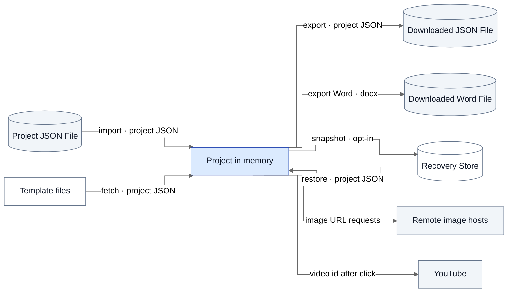

# Data Flows

**Purpose:** Where does project data come from, where is it kept, and where does it leave the browser?

**Scope:** Data flow · Browser App · audience: developer, security reviewer.

**Explanation:** Project content enters only from a file the user picks, a template served with the app, or the user's own recovery snapshot (EV-009, EV-011, EV-008). It leaves the browser only as a file the user downloads (EV-010, EV-031). The only outbound network traffic tied to content is the browser fetching image URLs written in documents and, after a click, the YouTube embed with the video id (EV-014, EV-016). The copy buffer stays in memory (EV-025). Nothing is uploaded and there is no analytics (EV-030).

**Evidence:** EV-008, EV-009, EV-010, EV-011, EV-014, EV-016, EV-025, EV-030, EV-031 — status `VERIFIED`.

**Limitations / Unknowns:** Third-party hosts receive the user's IP address, user agent and (for images) no referrer (the frame sets `no-referrer`); what they log is outside this system. The ChatGPT shortcut opens a page but sends no project data (EV-017).

**Related:** [External Systems](external-systems.md), [Security Architecture](../05-security-quality/security-architecture.md).

## Personal data leaving the system

| Data | Destination | When | Control | Evidence | Status |
|---|---|---|---|---|---|
| IP address, user agent | Remote image hosts | Opening a document with `http(s)` images | None (images load by default); `no-referrer` meta | EV-014 | VERIFIED |
| IP address, video id | YouTube (`youtube-nocookie.com`) | After pressing play | Click-to-load, sandboxed player | EV-016 | VERIFIED |
| Note content | Nowhere | — | No upload by design | EV-030 | VERIFIED |
| Note content as Word file | A file the user downloads (`.docx`) | After *Xuất Word* | Local build; web images are written as links, never fetched | EV-042, EV-044 | VERIFIED (working tree, uncommitted at 22407c0) |
