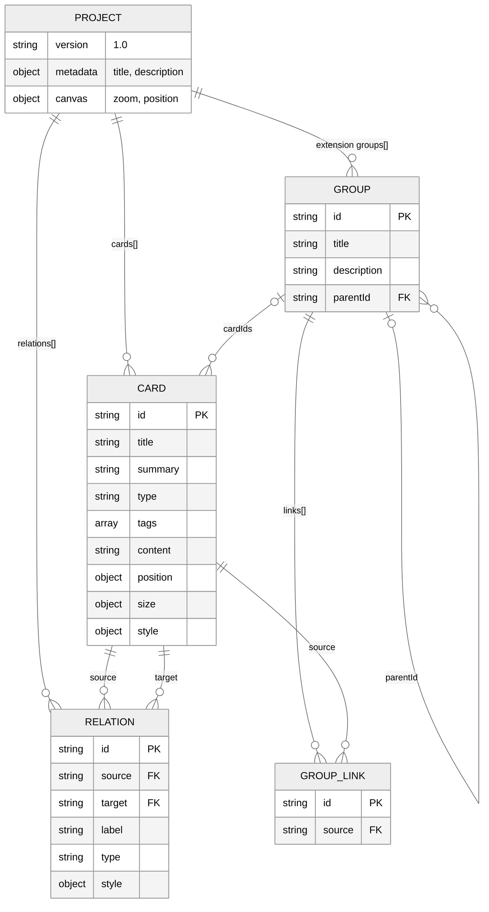

# Data Model

There is no database. The whole model is one JSON document, **project contract 1.0**, held in memory by the store and saved as a file. The canonical schema is `assets/js/json/schema.js` (used by the validator); `assets/data/project.schema.json` is the published copy, kept in sync by a unit test (EV-007).

**Purpose:** Which entities does a project file contain, and how do they reference each other?

**Scope:** Data model · project JSON contract 1.0 · audience: developer, AI agents producing files.

**Explanation:** All references are logical (ids inside one file), checked by the validator rather than by a database (EV-006). A card belongs to at most one group; a group has at most one parent and nests at most 3 levels (EV-024). Every relation must point at two existing cards and may not be a self-loop.

**Evidence:** EV-006, EV-007, EV-024 — status `VERIFIED`.

**Limitations / Unknowns:** Extension objects other than groups are shown in the table below, not as entities.

**Related:** [Business Rules](../02-features/business-rules.md), [Data Flows](data-flows.md), [ADR 0002](../07-decisions-changes/adr/0002-namespaced-extensions-contract.md).

## Fields and extensions

| Object | Required | Optional | Namespaced extensions | Evidence |
|---|---|---|---|---|
| Project | `version`, `cards`, `relations` | `metadata`, `canvas` | `card-atlas:groups`, `card-atlas:views` (Mind Map positions, sizes, viewport), `card-atlas:mind-map` (`rootId`) | EV-007 |
| Card | `id`, `title` | `summary`, `type`, `tags`, `content`, `position`, `size`, `style` | `typography`, `metadata` (pinned, created dates), `node` (kind, image fit), `appearance` (shape, radius, borders), `document` (`html-bs5` component tree), `images` (base64 attachments) | EV-007, EV-012, EV-032 |
| Relation | `id`, `source`, `target` | `label`, `description`, `type`, `style` | `edge` (route, corners, auto mode), `mind-map` (branch / reference, colour) | EV-007 |

Limits: file ≤ 10 MiB, ≤ 500 cards, ≤ 2,000 relations, ≤ 100,000 content characters per card; documents ≤ 3,000 nodes and depth 32 (EV-006, EV-012). Personal data: the app collects none itself; any personal data is whatever the user writes into notes.
