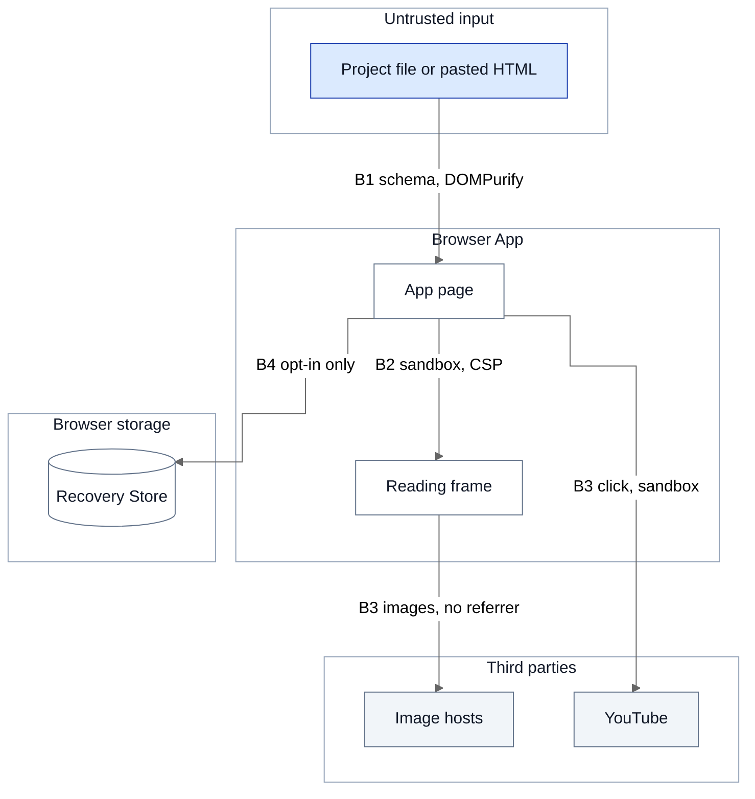

# Security Architecture

The main asset is the user's note content. The main threat is **untrusted content**: a project file or pasted HTML written by someone else (or by an AI) that tries to run script, leak data or break the app. There are no accounts, secrets or server.

**Purpose:** Which trust boundaries does data cross, and which control guards each one?

**Scope:** Security / trust boundaries · Browser App · audience: developer, security reviewer.

**Explanation:** Each arrow that crosses a zone shows its boundary ID and main control. B1: files are size-checked before reading, then schema-validated; HTML is reduced to an allowlist by DOMPurify, and base64 images are checked by magic bytes (EV-006, EV-012, EV-032). B2: documents render in a `srcdoc` iframe without `allow-scripts` and with CSP `default-src 'none'`; Mermaid SVG is sanitized again (EV-013, EV-015). B3: images load from any `http(s)` host; YouTube loads only after a click, from `youtube-nocookie.com`, in a sandboxed iframe (EV-014, EV-016). B4: browser storage is used only when the user enables recovery (EV-008).

**Evidence:** EV-006, EV-008, EV-012, EV-013, EV-014, EV-015, EV-016, EV-032 — status `VERIFIED`.

**Limitations / Unknowns:** `index.html` has no Content Security Policy of its own, so the app page relies on sanitizing alone (R-05). The GrapesJS editor canvas shows the same sanitized document in its own iframe; its sandbox settings were not reviewed (`UNKNOWN`).

**Related:** [Data Flows](../04-data-integrations/data-flows.md), [ADR 0003](../07-decisions-changes/adr/0003-sanitized-html-sandboxed-frame.md), [Known Risks](../07-decisions-changes/known-risks.md).

## Boundaries and controls

| ID | Boundary | Data crossing | Main controls | Evidence | Status |
|---|---|---|---|---|---|
| B1 | User file / pasted HTML → app | Project JSON, HTML, data-URL images | 10 MiB size check before read; Ajv schema; reference and limit checks; DOMPurify allowlist; image MIME + magic bytes | EV-006, EV-012, EV-032 | VERIFIED |
| B2 | App → reading frame | Sanitized document HTML, SVG | iframe `sandbox` without scripts; CSP `default-src 'none'`; Mermaid `strict` + second DOMPurify pass; diagram source policy | EV-013, EV-015 | VERIFIED |
| B3 | Browser → third-party hosts | Image URLs, YouTube video id | `no-referrer`; video click-to-load, nocookie domain, sandboxed player, id format check | EV-014, EV-016 | VERIFIED |
| B4 | App → browser storage | Full project snapshot | Opt-in flag; deleted when turned off; 20 MiB cap | EV-008 | VERIFIED |

## Control inventory

| Control | Where | Evidence | Status |
|---|---|---|---|
| Dev server serves only `/` and `/assets/`, bound to 127.0.0.1 | `scripts/serve.mjs` | EV-003 | VERIFIED |
| No upload, analytics or CDN | `AGENTS.md`, code search | EV-030 | VERIFIED |
| ChatGPT opened with `noopener,noreferrer`, no data passed | `ui/chatgpt-launcher.js` | EV-017 | VERIFIED |
| Page-level CSP | not present | EV-002 | VERIFIED (absent) |

## Threats per boundary (STRIDE)

| ID | Boundary | STRIDE | Threat | Mitigation | Residual | Evidence |
|---|---|---|---|---|---|---|
| T-001 | B1 | Tampering / Elevation | Malicious HTML in an imported file runs script in the app | DOMPurify allowlist on import and paste; stored as component tree | Depends on DOMPurify correctness; no page CSP as second layer (R-05) | EV-012 |
| T-002 | B1 | Denial of service | Huge or deeply nested file freezes the tab | 10 MiB check before reading; 500 cards; 3,000 nodes, depth 32 | Large but valid files still validate on every commit | EV-006, EV-012 |
| T-003 | B2 | Elevation | Script inside a rendered document | Script-less sandbox, CSP `default-src 'none'` | Same-origin sandbox: safe only while `allow-scripts` stays absent | EV-013 |
| T-004 | B2 | Tampering | Mermaid source injects HTML or links | Source policy, `strict`, `htmlLabels: false`, SVG sanitized, no `foreignObject` | Mermaid parser bugs | EV-015 |
| T-005 | B3 | Information disclosure | Opening a shared file pings an attacker's image host (tracking pixel) | `no-referrer` only | Images load by default (R-04) | EV-014 |
| T-006 | B3 | Information disclosure | YouTube tracking | Click-to-load, nocookie domain | Accepted once the user plays | EV-016 |
| T-007 | B4 | Information disclosure | Another user of the same browser profile reads the recovery snapshot | Opt-in, deleted when disabled | Snapshot is not encrypted | EV-008 |
