# Build and Release

**Purpose:** How does a change become a usable version of the app?

**Scope:** Release · repository to running app · audience: developer.

```mermaid
%%{init: {"theme": "neutral", "flowchart": {"curve": "step"}}}%%
flowchart LR
  accTitle: Release path of Card Atlas
  accDescr: A developer builds vendor bundles, runs the checks, commits to main and pushes; publishing static files anywhere is unknown.
  CH(["Code change"]) --> BLD["Build vendor bundles"]
  BLD --> CHK["Checks and tests (manual)"]
  CHK --> CM["Commit on main (manual)"]
  CM --> PU["Push to remote (manual)"]
  PU --> PUB["Publish static files (UNKNOWN)"]
  class CH accent

  classDef default fill:#FFFFFF,stroke:#64748B,color:#111827
  classDef accent fill:#DBEAFE,stroke:#1E40AF,color:#111827
```

**Explanation:** Commands for each step are in the table below. There is no pipeline. `npm run build` bundles libraries with esbuild into `assets/vendor/` (committed to git) and regenerates `assets/data/board-html-prompt.md` (EV-018, EV-035). The developer runs the checks by hand before committing (EV-019, EV-020). The released artifact is the repository's static files themselves; no versioned bundle is produced.

**Evidence:** EV-018, EV-019, EV-020, EV-027, EV-035 — status `VERIFIED` for build and checks; publishing `UNKNOWN`.

**Limitations / Unknowns:** Where the app is published, if anywhere, is unknown (EV-027). `package.json` stays at version 1.0.0 (EV-001); releases are not tagged.

**Related:** [Environments](environments.md), [Rollback](rollback.md).

## Step status

| Step | Command / place | Status | Evidence |
|---|---|---|---|
| Build vendor bundles and prompt | `npm run build` | implemented | EV-018, EV-035 |
| Unit, static, type, format checks | `npm test`, `npm run check`, `npm run typecheck`, `npm run format:check` | manual | EV-019, EV-020 |
| E2E | `npm run dev` + `npm run e2e` | manual | EV-020 |
| Commit and push | git, `main` branch | manual | — |
| Publish | — | unknown | EV-027 |

## Prerequisites

Node.js and npm (see [Local Setup](local-setup.md)); network access for `npm ci` only.

## Checklist

1. `npm ci && npm run build` if dependencies or the prompt changed.
2. Run the four static gates and the relevant E2E specs.
3. Commit `assets/vendor/` changes together with the code that needs them.
