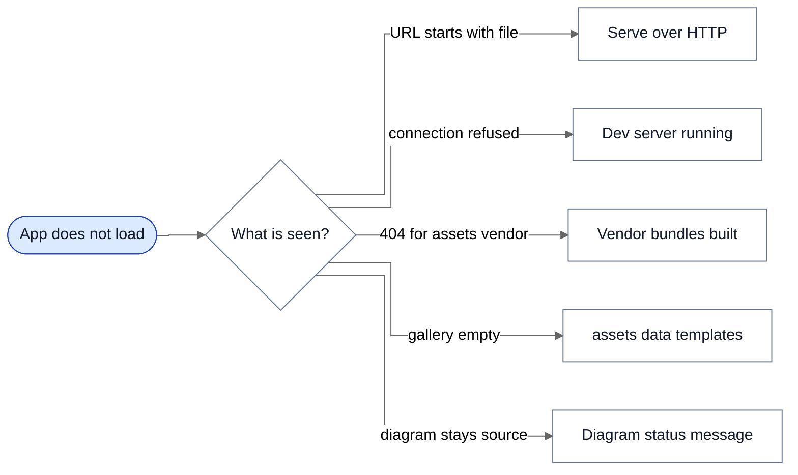

# Runbook — The App or the Editor Does Not Load

## Symptom / trigger

Blank page, the template gallery stays empty, the note editor never appears, or diagrams stay as source text.

## Severity / scope / owner

Blocks all work on that machine. Owner: `UNKNOWN`.

## Prerequisites and safety

- Local machine only; read-only checks first.
- Rebuilding `assets/vendor/` changes committed files: review `git status` afterwards.

## Diagnosis tree

**Purpose:** From what the user sees, what should be checked first?

**Scope:** Operations decision tree · symptom: app or editor does not load · audience: developer.

**Explanation:** The page loads `assets/js/app.js` as an ES module (EV-002), which only works over HTTP; the dev server serves only `/` and `/assets/` (EV-003). The editor, Mermaid and highlighting are loaded from `assets/vendor/`, which `npm run build` creates (EV-018). Templates are fetched from `assets/data/` (EV-011). A diagram that stays as text has its own status line (EV-015).

**Evidence:** EV-002, EV-003, EV-011, EV-015, EV-018 — status `VERIFIED`.

**Limitations / Unknowns:** Hosting outside the dev server is unknown; a different server must also serve `.js` as `text/javascript`.

**Related:** [Local Setup](../local-setup.md), [Container View](../../01-architecture/container-view.md).

## Diagnosis (read-only)

| Step | Command / UI | Expected signal | Evidence |
|---|---|---|---|
| 1 | Look at the address bar | `http://127.0.0.1:4173/` | EV-003 |
| 2 | Check the terminal running `npm run dev` | "Card Atlas: http://127.0.0.1:4173" | EV-003 |
| 3 | Browser DevTools → Console and Network | No 404 for `assets/vendor/*.js`, no module errors | EV-018 |
| 4 | `git status assets/vendor` | Bundles present and unchanged | EV-018 |
| 5 | Open `http://127.0.0.1:4173/assets/data/template-catalog.json` | JSON is returned | EV-011 |

## Mitigation / recovery

| Action | Approval needed | Risk | Verification |
|---|---|---|---|
| Start the server: `npm run dev` | No | Port 4173 already used by another process | Page loads |
| Rebuild bundles: `npm ci && npm run build` | Developer | Rewrites `assets/vendor/` (line endings may show as changes) | Editor opens; `git diff --stat assets/vendor` reviewed |
| Diagram status "not supported" | No | — | Remove `style`, `classDef`, `click`, `%%{` or URLs from the diagram |

## Rollback / escalation

- Rollback: `git checkout -- assets/vendor` restores the committed bundles.
- Escalation contact (role): `UNKNOWN`.

## Audit notes

- Incident ID / date: none recorded.
