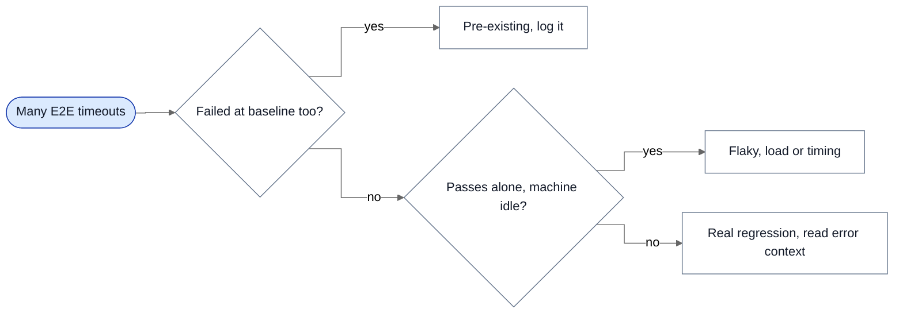

# Runbook — E2E Suite Times Out

## Symptom / trigger

`npm run e2e` reports many failures, most of them `Test timeout of 30000ms exceeded` while waiting for a button or locator.

## Severity / scope / owner

Blocks trusting E2E results; no user impact by itself. About 104 tests failed this way before recent changes (EV-036). Owner: `UNKNOWN`.

## Prerequisites and safety

- Local machine; tests only read and write the browser under test.
- Never weaken or delete a test to make it pass (project rule in `CLAUDE.md`).

## Diagnosis tree

**Purpose:** Is a failure a real regression, a pre-existing failure or an environment problem?

**Scope:** Operations decision tree · symptom: E2E timeouts · audience: developer.

**Explanation:** Playwright runs with one worker, a 30-second test timeout and the dev server on port 4173 (EV-020). In the 2026-11-14 run, failures that were not in the baseline mostly passed when rerun alone, while the old failures failed the same way (EV-036). Their root cause has not been investigated.

**Evidence:** EV-020, EV-036 — status `INFERRED` for the failure pattern.

**Limitations / Unknowns:** Why the baseline tests time out is `UNKNOWN`; candidates (UI text or selectors that changed, slower machine) are not verified.

**Related:** [Test Strategy](../../05-security-quality/test-strategy.md), [Known Risks](../../07-decisions-changes/known-risks.md) R-02.

## Diagnosis (read-only)

| Step | Command / UI | Expected signal | Evidence |
|---|---|---|---|
| 1 | Save the run: `npx playwright test --project=chrome --reporter=list > run.txt` | List of `x` lines | EV-020 |
| 2 | Run the same command on the last known good commit (separate worktree and port) | Baseline list | EV-036 |
| 3 | Compare test names between the two lists | New failures only | EV-036 |
| 4 | Rerun each new failure alone: `npx playwright test <spec> -g "<name>" --project=chrome` | Pass → flaky | EV-020 |
| 5 | Open `test-results/<test>/error-context.md` for real failures | Which locator was missing | EV-020 |

## Mitigation / recovery

| Action | Approval needed | Risk | Verification |
|---|---|---|---|
| Fix the code that broke a test, or update a test whose expected UI changed on purpose | Developer | Hiding a real bug | Spec passes twice |
| Close other heavy programs, keep one worker | No | — | Fewer timeouts |

## Rollback / escalation

- Rollback: revert the commit that introduced a real regression ([Rollback](../rollback.md)).
- Escalation contact (role): `UNKNOWN`.

## Audit notes

- 2026-11-14: 459 passed, 114 failed on Chrome; 104 pre-existing (EV-036).
