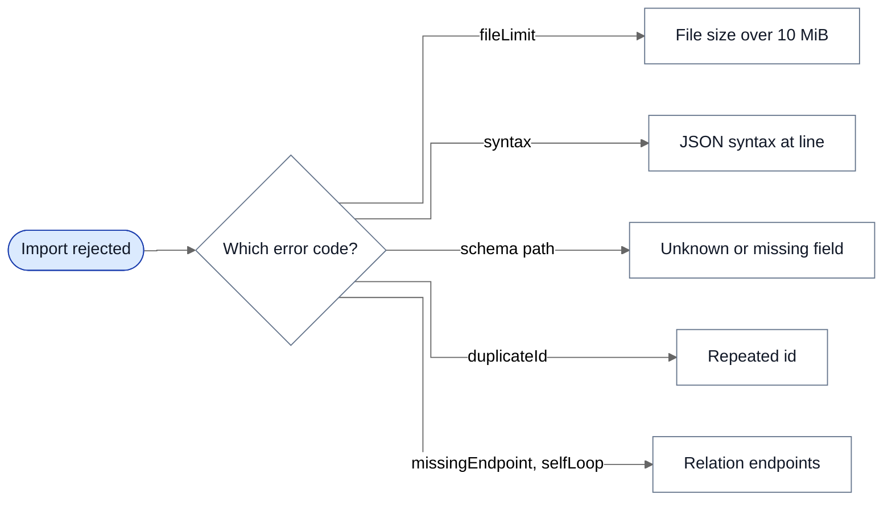

# Runbook — A Project File Is Rejected on Import

## Symptom / trigger

The import preview lists errors and *Áp dụng* is disabled, or a toast says the file cannot be read.

## Severity / scope / owner

One user, one file. The current project is not affected (import works on a copy, EV-009). Owner: `UNKNOWN`.

## Prerequisites and safety

- Work on a **copy** of the rejected file; keep the original untouched.
- Nothing on a server is involved; no approval needed.

## Diagnosis tree

**Purpose:** From the error shown in the preview, what should be checked first?

**Scope:** Operations decision tree · symptom: import rejected · audience: user, developer.

**Explanation:** The preview shows each error as `path: message` (EV-009). The codes come from `stage` and `validate` in `assets/js/json/validator.js` (EV-006); schema errors name the JSON path of the offending field (EV-007).

**Evidence:** EV-006, EV-007, EV-009 — status `VERIFIED`.

**Limitations / Unknowns:** The full list of schema messages is generated by Ajv and is not enumerated here.

**Related:** [Import workflow](../../03-workflows/forms/import-project.md), [Data Model](../../04-data-integrations/data-model.md).

## Diagnosis (read-only)

| Step | Command / UI | Expected signal | Evidence |
|---|---|---|---|
| 1 | Read the error list in the import preview | `path` + code | EV-009 |
| 2 | Check file size in the file manager | ≤ 10 MiB | EV-006 |
| 3 | Open the file in a JSON-aware editor at the reported line | Valid JSON | EV-006 |
| 4 | Compare the field at `path` with `assets/data/project.schema.json` | Field allowed; extensions namespaced `card-atlas:*` | EV-007 |
| 5 | Search the file for the reported id | Unique ids; relations point to existing cards | EV-006 |

## Mitigation / recovery

| Action | Approval needed | Risk | Verification |
|---|---|---|---|
| Fix the reported field in the copy and import again | No | Low | Preview shows no errors |
| Remove large base64 images to get under 10 MiB | No | Images lost in that copy | Size ≤ 10 MiB |
| File written by a newer Card Atlas version (unknown field) | No | — | Open it in the newer version |
| Legacy Markdown project | No | — | Convert with `scripts/convert-markdown-files.mjs` ([migration](../../07-decisions-changes/migrations/markdown-to-html-document.md)) |

## Rollback / escalation

- Rollback: not needed; the current project was not changed.
- Escalation contact (role): `UNKNOWN`.

## Audit notes

- Incident ID / date: none recorded.
