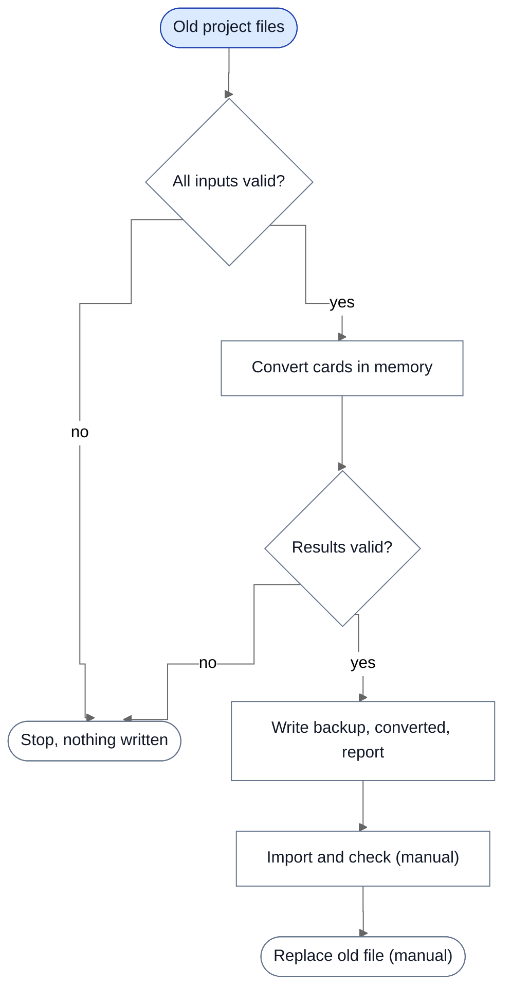

# Migration — Legacy Markdown Notes to HTML Documents

**Purpose:** Which control steps does the legacy Markdown conversion go through, and where can it stop?

**Scope:** Operations workflow · migration: Markdown `content` to `html-bs5` documents · audience: developer, user with old files.

**Explanation:** "Valid" includes the 10 MiB size limit, before and after conversion. `node scripts/convert-markdown-files.mjs --out <new-folder> <input.json> …` reads and validates every input, converts each card's Markdown into a `card-atlas:document` component tree, validates each result and only then writes anything (EV-026, EV-006). The output folder must not exist; it gets `backup/` (byte-identical originals), `converted/` and `report.json` with SHA-256 hashes and per-card warnings. Mermaid stays as source and is drawn by the reading view; old raw HTML and external images are kept as labelled source and not executed or loaded (EV-012). Checking the result and replacing the old file are manual.

**Evidence:** EV-006, EV-012, EV-026 — status `VERIFIED`.

**Limitations / Unknowns:** How many legacy files still exist is `UNKNOWN`.

**Related:** [Rollback](../../06-operations/rollback.md), [Backup and Restore](../../06-operations/backup-restore.md), [ADR 0003](../adr/0003-sanitized-html-sandboxed-frame.md).

| Migration | Source → target | Transformation | Validation | Rollback | Status |
|---|---|---|---|---|---|
| Markdown → HTML document | Card `content` (Markdown) → `extensions["card-atlas:document"]` (`html-bs5`) | `convertMarkdownCard` per card, offline CLI | Full project validation before and after; size limits | Keep using the original from `backup/` | VERIFIED (EV-026) |

- The tool runs locally and uploads nothing.
- Re-running on the same input into a new folder is safe; files are written with `wx` (never overwrite).
